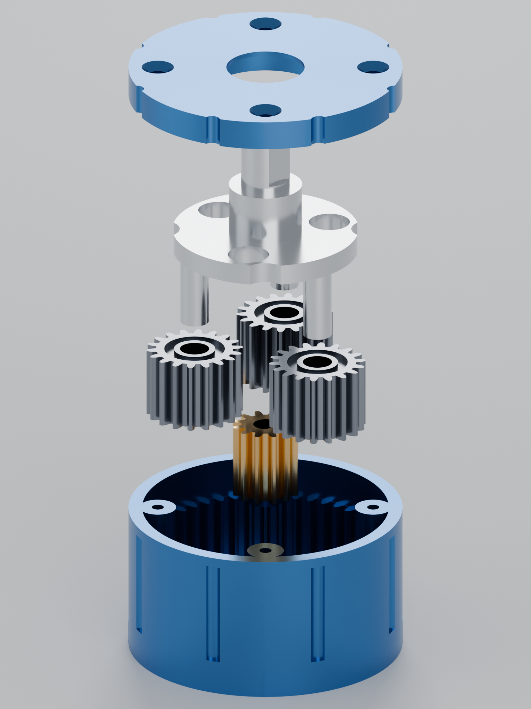
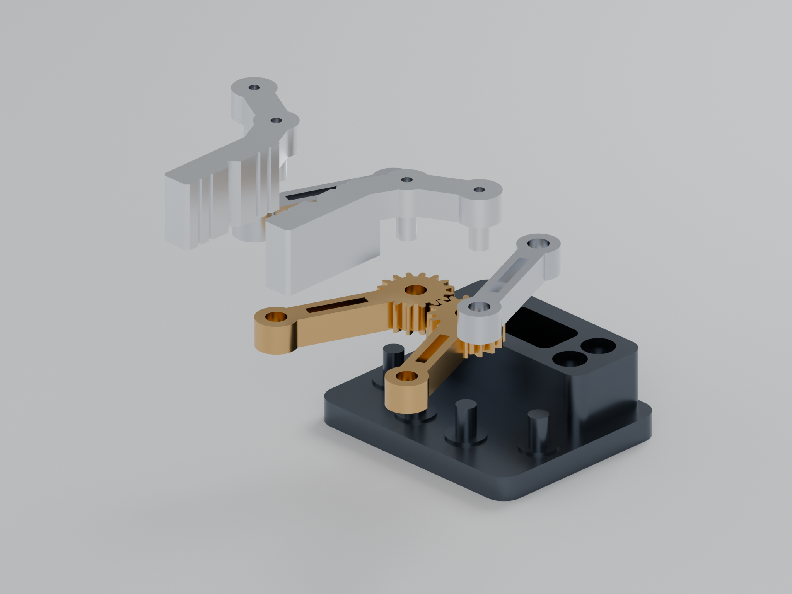

# Mechanical CAD & DFM Engineering Portfolio

Precision 3D solid modeling, manufacturing-ready `.STEP` (AP214) & watertight `.STL` assemblies, **DFM** *(Design for Manufacturing)* & kinematic validation, and studio **PBR** *(Physically Based Rendering)* product visualizations.

---

## Featured Mechanical Assemblies

### 01. IP65 CNC-Machined 6061-T6 Robotics Controller Enclosure
* **Files in [`./Project1`](./Project1):** `IP65_Robotics_Enclosure_Assembled.step`, `IP65_Robotics_Enclosure_Exploded.step`, `IP65_Robotics_Enclosure_Exploded.stl`, `Project1_IP65_Enclosure_4K_Exploded.png`
* **Envelope & Mass:** `140.0 × 95.0 × 42.0 mm` | `334.6 cm³` unobstructed internal cavity | `0.417 kg` (6061-T6 Aluminum)
* **Engineering Highlights:**
  * Continuous `2.0 × 1.5 mm` perimeter elastomer O-ring gland clearing `6× M3` countersunk lid fasteners.
  * `2× M16×1.5` waterproof cable gland ports with exterior EPDM washer spotfaces and internal thread-reinforcing pads.
  * `4×` internal `M2.5` PCB standoffs, `R2.5 mm` internal pocket radii (`Ø5.0 mm` CNC endmill ready), and `11×` chamfered top heatsink fins.
* **Validation:** Watertight binary STL (`23,204` triangles), `2` verified solids, zero wall-thickness violations (`3.0 mm` uniform walls).

---

### 02. NEMA-17 5:1 Planetary Gearbox Actuator (7-Solid Assembly)
* **Files in [`./Project2`](./Project2):** `NEMA17_Planetary_Gearbox_Assembled.step`, `NEMA17_Planetary_Gearbox_Exploded.step`, `NEMA17_Planetary_Gearbox_Assembled.stl`, `NEMA17_Planetary_Gearbox_Exploded.stl`, `Project2_Planetary_Gearbox_2K_Exploded.png`
* **Kinematics & Envelope:** `5.0:1` reduction (`m = 1.0 mm`, `Z_sun = 12`, `3× Z_planet = 18`, `Z_ring = 48`) | `56.0 × 56.0 × 48.0 mm` | `0.243 kg`
* **Engineering Highlights:**
  * Standard NEMA-17 mounting flange (`42.3 mm` square, `31.0 mm` M3 bolt span, `Ø22.2 mm` pilot recess) and `Ø5.0 mm` D-bore sun pinion.
  * `7`-station smooth convex involute tooth profiles with `0.055 mm` per-flank backlash (`1.1°` measured sun backlash).
  * Flush `5.0 mm` deep `6802ZZ` output ball-bearing seat, `Ø10.0 mm` D-cut output shaft, and `4× Ø9.0 mm` carrier relief scallops.
* **Validation:** `0.0000 mm³` interference across all `21` component pairs + synchronous `+1.0°` sun / `-0.667°` planet kinematic mesh sweep (`36,782` watertight triangles).

---

### 03. Servo-Driven Parallel-Jaw Robotic Gripper (7-Solid Assembly)
* **Files in [`./Project3`](./Project3):** `Parallel_Robotic_Gripper_Assembled.step`, `Parallel_Robotic_Gripper_Exploded.step`, `Parallel_Robotic_Gripper_Assembled.stl`, `Parallel_Robotic_Gripper_Exploded.stl`, `Project3_Robotic_Gripper_2K_Exploded.png`
* **Kinematics & Envelope:** `4`-Bar Parallelogram Linkage (`L = 34.0 mm`, `(8, 15, 17) mm` Pythagorean base pivot spacing) | `82.0 × 108.5 × 21.5 mm` | `0.176 kg`
* **Engineering Highlights:**
  * Synchronized `16`-tooth (`m = 1.0 mm`) phosphor bronze drive gear arms with `0.055 mm` per-flank backlash (`0.000000 mm` parallelogram vector error).
  * `0.0 mm` to `50.6 mm` parallel jaw stroke (`24.0 mm` nominal opening at `θ = 22°`) with `90°` self-centering vertical V-grooves and anti-slip serrations.
  * Rear robot-wrist flange (`4× M4` counterbored pattern) with `0.40–0.50 mm` axial thrust clearances and `Ø4.84 mm` running-fit pivot pins.
* **Validation:** Full-stroke `θ = 3°–50°` kinematic sweep with `0.0000 mm³` interference across all `21` pairs (`23,832` watertight STL triangles).

