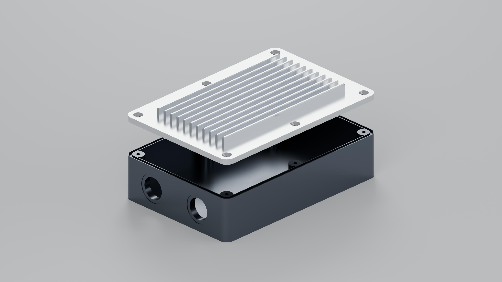

# Parametric Mechanical CAD & DFM Engineering Portfolio

Programmatic 3D solid modeling, manufacturing-ready `.STEP` / `.STL` assemblies, automated **DFM** *(Design for Manufacturing)* verification suites, and studio **PBR** *(Physically Based Rendering)* visualizations built using **Python (`cadquery` / OpenCASCADE)**, **Onshape**, and **Blender 4.0 Cycles**.

---

## Featured Assemblies

### 01. IP65 CNC-Machined 6061-T6 Robotics Controller Enclosure
* **Files:** [`./Project1`](./Project1) (`Assembled.step`, `Exploded.step`, `Exploded.stl`, `Build_Script.py`, `Verification_Report.md`)
* **Envelope & Mass:** `140.0 × 95.0 × 42.0 mm` | `334.6 cm³` unobstructed internal cavity | `0.417 kg` (6061-T6 Aluminum)
* **Engineering Highlights:**
  * Continuous `2.0 × 1.5 mm` perimeter elastomer O-ring gland clearing `6× M3` countersunk lid fasteners.
  * `2× M16×1.5` waterproof cable gland ports with exterior EPDM washer spotfaces and internal thread-reinforcing pads.
  * `4×` internal `M2.5` PCB standoffs, `R2.5 mm` internal pocket radii (`Ø5.0 mm` CNC endmill ready), and `11×` chamfered top heatsink fins.
* **Verification:** Watertight binary STL (`23,204` triangles), `2` verified solids, zero wall-thickness violations (`3.0 mm` uniform walls).

---

### 02. NEMA-17 5:1 Planetary Gearbox Actuator (7-Solid Assembly)
* **Files:** [`./Project2`](./Project2) (`Assembled.step`, `Exploded.step`, `Assembled.stl`, `Exploded.stl`, `Build_Script.py`, `Verification_Report.md`)
* **Kinematics & Envelope:** `5.0:1` reduction (`m = 1.0 mm`, `Z_sun = 12`, `3× Z_planet = 18`, `Z_ring = 48`) | `56.0 × 56.0 × 48.0 mm` | `0.243 kg`
* **Engineering Highlights:**
  * Standard NEMA-17 mounting flange (`42.3 mm` square, `31.0 mm` M3 bolt span, `Ø22.2 mm` pilot recess) and `Ø5.0 mm` D-bore sun pinion.
  * `7`-station smooth convex involute tooth profiles with `0.055 mm` per-flank backlash (`1.1°` measured sun backlash).
  * Flush `5.0 mm` deep `6802ZZ` output ball-bearing seat, `Ø10.0 mm` D-cut output shaft, and `4× Ø9.0 mm` carrier relief scallops.
* **Verification:** `0.0000 mm³` interference across all `21` component pairs + synchronous `+1.0°` sun / `-0.667°` planet kinematic mesh sweep (`36,782` watertight triangles).

# CAD_Projects
